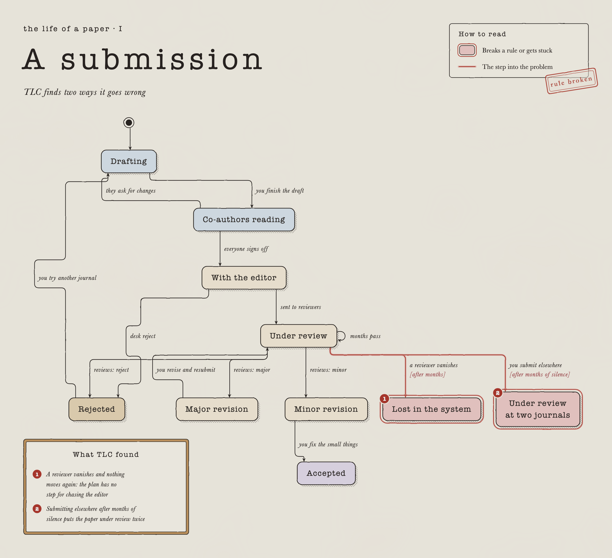
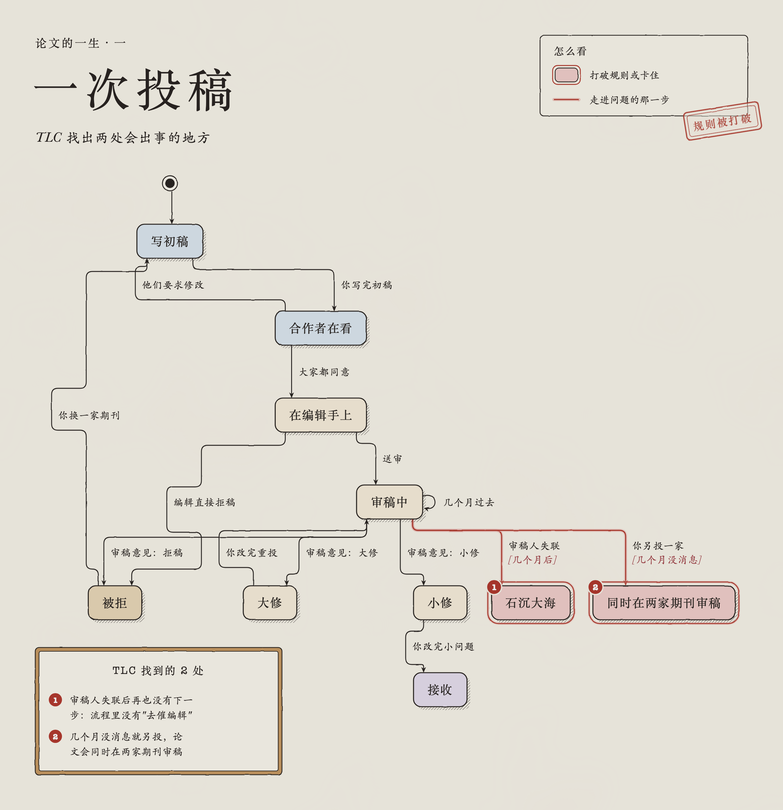

# draw-flowchart

An agent skill that draws flowcharts and state diagrams as paper-style posters: cream paper, typewriter type, hatched shadows, right-angle connectors, and the problems in a process ringed in red. It exports `poster.html` (self-contained, works offline), `poster.png` and `poster.svg`.



**How it splits the work**

1. **The agent writes the Mermaid.** Ideally it models the process with [pstack](https://github.com/cursor/plugins/tree/main/pstack)'s `/statechart`, so TLC checks every reachable state and finds where the process gets stuck or breaks a rule. Those problems become the red boxes.
2. **A script draws it.** `make_poster.py` uses a fixed template and a bundled copy of dagre for layout; no model is involved, so the same input always gives the same poster. A cheaper model (or you) then looks over the PNG.

## Install

**Claude Code (plugin)**

```
/plugin marketplace add birchloveye/draw-flowchart
/plugin install draw-flowchart@draw-flowchart
```

**Claude Code, Cursor, Codex or any agent that reads `SKILL.md` (copy the folder)**

```bash
git clone https://github.com/birchloveye/draw-flowchart
cp -r draw-flowchart/skills/draw-flowchart ~/.claude/skills/     # Claude Code
cp -r draw-flowchart/skills/draw-flowchart ~/.cursor/skills/     # Cursor
# other agents: copy it into their skills folder, or tell the agent to read skills/draw-flowchart/SKILL.md
```

Then ask the agent for a flowchart, a state diagram or a process figure.

**Without an agent**

```bash
python3 skills/draw-flowchart/scripts/make_poster.py examples/paper-submission
```

## Requirements

- Python 3.8+ (standard library; Pillow optional)
- Chrome, Edge or Chromium for PNG/SVG export (set `CHROME` if it is not found)
- Optional: pstack plus Java 11+ for the TLA+ check

## What is in the repository

| Path | What |
|---|---|
| `skills/draw-flowchart/SKILL.md` | the instructions the agent follows |
| `skills/draw-flowchart/scripts/make_poster.py` | check, render, export; `--init` writes a starter, `--from-statechart` converts pstack output |
| `skills/draw-flowchart/assets/template.html` | the renderer; every setting is in `CONFIG` at the top |
| `skills/draw-flowchart/references/` | Mermaid rules, `poster.json` fields, the pstack hand-off |
| `examples/paper-submission/` | a TLA+ model of a journal submission, its statechart output and the poster; `-zh` is the Chinese view |

## Limits

Top-to-bottom layout only; no composite states, parallel regions, notes or subgraphs; best at 15–25 boxes.

## Credits

The look is inspired by Kevin Ngo's "the business of boba" diagrams ([post](https://x.com/kevin_t_ngo/status/2116270190040416313)), made with pstack's `/statechart`. Layout by [dagre](https://github.com/dagrejs/dagre) (MIT, see `THIRD_PARTY_NOTICES.md`).

---

## 中文说明

一个给 AI 助手用的技能（skill）：把流程图、状态图画成海报风格（米色纸、打字机字、斜线阴影、直角连线、问题用红框标出），输出 `poster.html`（单文件，离线能开）、`poster.png`、`poster.svg`。



**分工**

1. **助手写 Mermaid**：最好先用 pstack 的 `/statechart` 把流程写成 TLA+ 模型，让 TLC 把每个能走到的状态都查一遍，找出会卡住、会违反规则的地方，这些就是图上的红框。
2. **脚本画图**：`make_poster.py` 用固定模板和自带的 dagre 排版，不用模型，同一份输入每次画出来一样。最后让便宜的模型或你自己看一眼 PNG。

**安装**：Claude Code 里运行上面两条 `/plugin` 命令；Cursor、Codex 等支持 `SKILL.md` 的助手，把 `skills/draw-flowchart` 文件夹拷进它的 skills 目录。装好后直接说"画一个……的流程图"。

**不用助手**：`python3 skills/draw-flowchart/scripts/make_poster.py <文件夹>`，文件夹里放 `flow.mmd`（写法见 `references/mermaid-rules.md`）和 `poster.json`（字段见 `references/poster-json.md`）。`--init --lang zh` 生成中文起步模板。

**限制**：只能从上往下排；不支持嵌套状态、并行区域、注释框、子图；15–25 个框效果最好。中文在 Linux 上要装 Noto Serif CJK 之类的字体。

## License

MIT
